Here’s the clear and simple version of the video notes:

---

### Amazon EC2 (Elastic Compute Cloud)

Amazon EC2 is a service that lets you rent **virtual servers** in the cloud.  
These virtual servers are called **EC2 instances**.

---

### Quick Reminder: Client-Server Model
Remember the coffee shop example:
- Customer (Client) asks for a latte
- Barista (Server) prepares it and gives it back

The same idea is used by almost every business (healthcare, insurance, video streaming, etc.).  
They all need **compute power** (servers) to run their applications and serve customers.

---

### Why Use EC2 Instead of Your Own Servers?

**Traditional way (On-premises):**
- You buy physical servers
- You install them in a data center
- It takes a lot of time and money

**With Amazon EC2:**
- AWS already has a huge amount of compute capacity ready
- You just request the servers you need
- They are ready in a few minutes
- When you finish, you can stop or delete them
- You only pay for the time the instances are **running**

---

### What is an EC2 Instance?
An EC2 instance is a **virtual machine (VM)**.

Multiple virtual machines share the same physical server.  
This is called **multi-tenancy**.

AWS uses a special software called a **hypervisor** to:
- Share the physical server resources
- Keep each virtual machine completely isolated and secure

You don’t manage the physical server or the hypervisor — AWS does that for you.

---

### What Can You Control on an EC2 Instance?

When you create an EC2 instance, you can choose:

- **Operating System** → Windows or Linux
- **Software** → Your own applications, websites, databases, or third-party software
- **Size** → You can make the instance bigger or smaller (this is called **vertical scaling**)
- **Networking** → Decide if the instance is public or private

You have full control over what runs on the instance.

---

### Key Benefits of EC2

- Very flexible
- Fast to start (minutes instead of weeks)
- Cost-effective (pay only for what you use)
- Easy to resize when needed
- No long-term commitment

---

**In short:**  
Amazon EC2 gives you virtual servers in the cloud that you can launch, configure, and stop whenever you want — without buying or managing physical hardware.

Here’s the clear and simple version:

---

### Amazon EC2 – Key Points

Amazon EC2 is more **flexible**, **cost-effective**, and **faster** than managing your own servers on-premises.

You can:
- Launch servers when you need them
- Scale them up or down easily
- Stop or terminate them when you no longer need them
- Pay only for the time they are running

---

### Comparing On-Premises vs Cloud Resources

#### Challenges of On-Premises Resources
If you want to create new websites using traditional servers:
- You must buy the hardware in advance
- Wait for delivery
- Install and configure everything yourself
- You are locked into a fixed capacity

This process is slow, expensive, and inflexible.

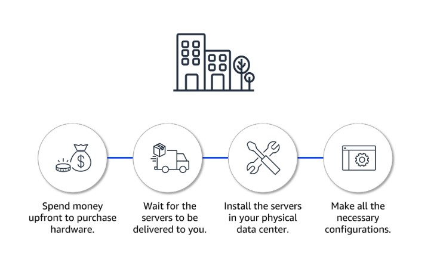

---

#### Benefits of Using Cloud Resources (Amazon EC2)
With EC2:
- You can launch instances in minutes
- Scale up or down based on demand
- Stop instances when traffic is low
- No big upfront costs

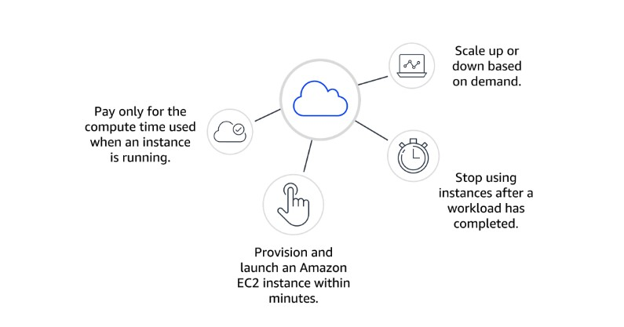

---

### How Amazon EC2 Works (3 Simple Steps)

#### 1. Launch an Instance
When you create an EC2 instance, you choose:
- **Amazon Machine Image (AMI)** → This is the operating system (Windows or Linux) + any pre-installed software
- **Instance Type** → This decides the power of the server (CPU, memory, network performance)

#### 2. Connect to the Instance
You can connect to the instance in different ways:
- Applications can talk to it over the network
- For Linux → Use **SSH**
- For Windows → Use **Remote Desktop (RDP)**
- Or use AWS tools like **AWS Systems Manager** (safer and easier)

#### 3. Use the Instance
Once connected, you can:
- Run commands
- Install software
- Add storage
- Organize files
- Run your applications

---

**Summary:**  
Amazon EC2 gives you virtual servers that you can start, use, and stop whenever you need — without the long waiting time and high cost of buying physical servers.

---
Here’s the clear and simple version:

---

### Amazon EC2 Instance Types

Amazon EC2 offers many different types of virtual servers (instances).  
Each type is designed for a different kind of work.

**Coffee Shop Analogy:**  
Just like a coffee shop needs different machines for different drinks  
(espresso machine, drip coffee machine, cold brew machine…),  
you need different EC2 instance types for different workloads.

---

### The 5 Main Instance Families

| Instance Family              | Best For                                      | Simple Example                          |
|-----------------------------|-----------------------------------------------|-----------------------------------------|
| **General Purpose**         | Balanced CPU, memory, and networking          | Websites, code repositories, small apps |
| **Compute Optimized**       | Heavy CPU work                                | Gaming servers, high-performance computing, scientific modeling |
| **Memory Optimized**        | Workloads that need a lot of memory           | Processing large data sets in memory    |
| **Accelerated Computing**   | Tasks that need special hardware (GPU, etc.)  | Graphics processing, machine learning, pattern matching |
| **Storage Optimized**       | High performance with local storage           | Workloads that read/write large amounts of data very fast |

---

### Choosing the Right Size

After choosing the **type** (family), you also choose the **size**.

- Bigger size = more CPU, more memory, more power → higher cost  
- Smaller size = less power → lower cost  

**Tip:**  
Always try to balance performance and cost.  
Don’t pay for more power than you actually need.

---

### Important Point

You are **not locked** into one instance type or size forever.  

If the one you chose is too small or too big, you can easily change it later.  
This flexibility is one of the biggest advantages of the cloud.

---

**Summary:**  
Choose the right instance family based on your workload, then choose the right size based on your performance needs and budget.

---

Here’s the clear and simple version:

---

### How to Provision AWS Resources

In AWS, almost everything is done through **API calls**.  
An API is a set of predefined methods that let you create, manage, and configure AWS resources.

There are **3 main ways** to interact with AWS:

1. AWS Management Console  
2. AWS Command Line Interface (AWS CLI)  
3. AWS Software Development Kit (AWS SDK)

---

### 1. AWS Management Console
- Browser-based (point-and-click interface)
- Very easy and visual
- Perfect for beginners

**Good for:**
- Learning AWS
- Setting up test environments
- Checking bills
- Monitoring resources
- Doing simple or non-technical tasks

**Limitation:**  
Manual clicking can lead to mistakes, especially when you need to do the same task many times.

---

### 2. AWS Command Line Interface (AWS CLI)
- You type commands in a terminal
- Works on Windows, macOS, and Linux
- Allows automation through scripts

**Good for:**
- Advanced users and developers
- Automating tasks (example: launching many EC2 instances automatically)

**Example commands:**
- `aws ec2 run-instances` → Launch an EC2 instance  
- `aws ec2 describe-availability-zones` → List Availability Zones

You can also use **AWS CloudShell** (a browser-based terminal with the CLI already installed).

---

### 3. AWS Software Development Kit (AWS SDK)
- Lets you control AWS services using programming languages (Python, Java, JavaScript, C++, .NET, etc.)
- Useful when you want your application to talk directly to AWS

**Good for:**
- Developers who want to integrate AWS services into their own applications

---

### Summary Table

| Method                  | How it works                          | Best for                              |
|-------------------------|---------------------------------------|---------------------------------------|
| **Management Console**  | Point and click in the browser        | Learning, testing, simple tasks       |
| **AWS CLI**             | Type commands in a terminal           | Automation and scripting              |
| **AWS SDK**             | Write code in a programming language  | Building applications that use AWS    |

No matter which method you use, behind the scenes you are always calling the same AWS APIs.

---

### Compute and the Shared Responsibility Model

Remember the **Shared Responsibility Model**:

- **AWS** is responsible for security **of** the cloud (physical hardware, data centers, networking, hypervisor)
- **You (the customer)** are responsible for security **in** the cloud (your data, applications, operating system, access control)

#### Unmanaged Service Example: Amazon EC2
Amazon EC2 is an **unmanaged service**.

This means:
- You are responsible for managing the guest operating system
- You must apply security updates and patches
- You configure security groups (firewalls)
- You manage the applications and data running on the instance

AWS only manages the physical hardware and the hypervisor underneath.

---

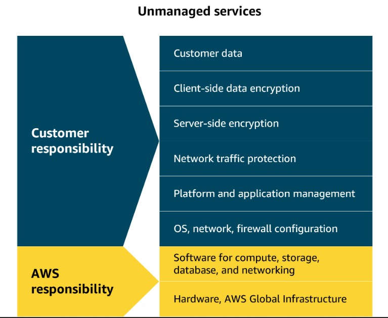

---
# Amazon EC2 & Amazon Machine Images (AMIs)

## Demo: Launching an Amazon EC2 Instance

When setting up an EC2 instance, you need to choose several key configurations:

- AMI (the template)
- Instance type
- Storage
- Security group
- Key pair
- Network settings

---

## What is an AMI?

An **Amazon Machine Image (AMI)** is a pre-built virtual machine image.  
It contains all the basic components needed to start an EC2 instance.

---

## AMI Repeatability

AMIs provide **repeatability** by giving every new instance a consistent environment.

- Configurations are identical
- Deployments can be automated
- Development and testing environments stay consistent
- Helps when scaling applications
- Reduces errors
- Makes managing large environments easier

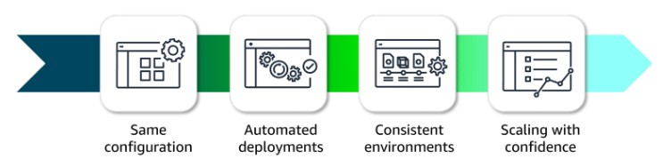

---

## AMI Components

An AMI includes:

- Operating system
- Storage setup
- Architecture type
- Launch permissions
- Any extra pre-installed software

You can use **one AMI** to launch multiple EC2 instances that all have the same setup.

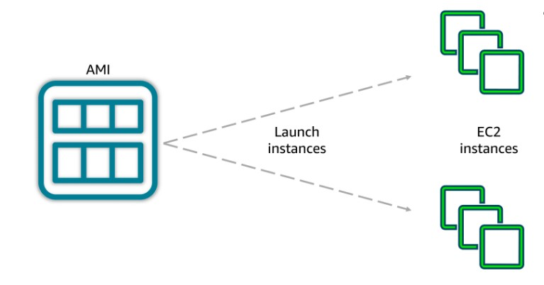

---

## Three Ways to Use AMIs

1. **Create your own**  
   Build a custom AMI with the exact configurations and software you need.

2. **Use AWS-provided AMIs**  
   Ready-made images from Amazon for common operating systems and software.

3. **Purchase from the AWS Marketplace**  
   Specialized AMIs offered by third-party vendors for specific use cases.

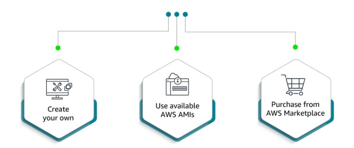

# Amazon EC2 Pricing – Simple & Clear Explanation

Amazon EC2 offers different pricing options so you can choose the most cost-effective way to run your servers based on your needs.

---

## 1. On-Demand Instances
- Pay only for what you use (by the hour or second)
- No long-term commitment
- **Best for:** Short-term, unpredictable, or testing workloads

---

## 2. Reserved Instances (RIs)
- Commit for 1 or 3 years
- Save up to **75%** compared to On-Demand
- **Best for:** Steady, predictable workloads that run continuously

**RI Flexibility:**  
The discount can automatically apply to different instance sizes in the same family and across Availability Zones in the same Region.

---

## 3. Spot Instances
- Bid on unused EC2 capacity
- Save up to **90%** compared to On-Demand
- AWS can interrupt the instance with short notice
- **Best for:** Flexible, fault-tolerant workloads (batch jobs, big data, CI/CD, etc.)

---

## 4. Savings Plans
- Commit to a certain amount of usage (per hour) for 1 or 3 years
- Save up to **72%**
- More flexible than Reserved Instances (works across instance types, regions, and even other services like Lambda and Fargate)
- **Best for:** Predictable overall usage, but you want flexibility

---

## 5. Dedicated Hosts vs Dedicated Instances

| Feature                  | Dedicated Hosts                          | Dedicated Instances                     |
|--------------------------|------------------------------------------|-----------------------------------------|
| What you get             | Entire physical server just for you      | Instances on dedicated hardware         |
| Control                  | Full control over placement              | No control over which physical server   |
| Best for                 | Strict licensing or compliance needs     | Isolation from other customers          |

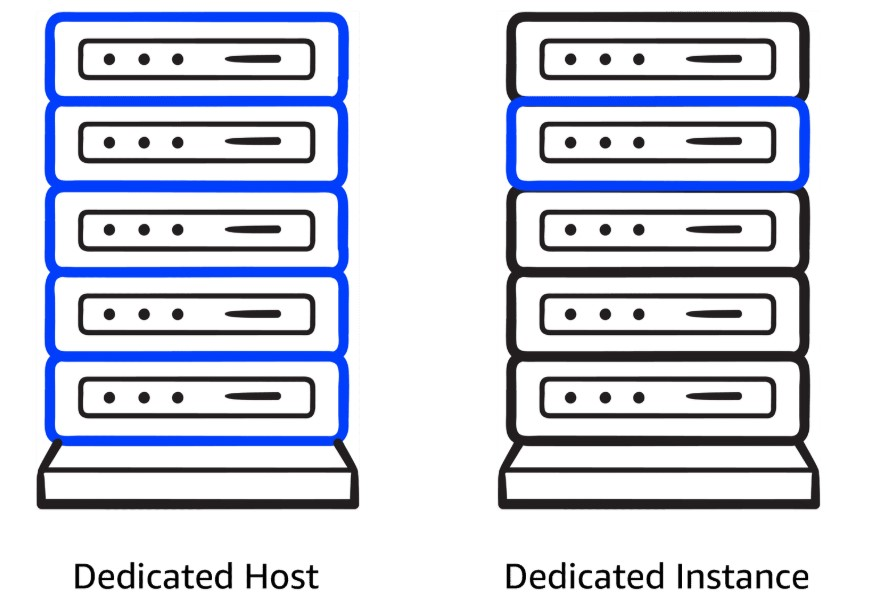

---

## Quick Summary – When to Use What

| Pricing Option         | Savings     | Commitment | Best Use Case                          |
|------------------------|-------------|------------|----------------------------------------|
| **On-Demand**          | None        | None       | Testing, unpredictable workloads       |
| **Spot**               | Up to 90%   | None       | Flexible / interruptible workloads     |
| **Savings Plans**      | Up to 72%   | 1 or 3 yrs | Predictable usage with flexibility     |
| **Reserved Instances** | Up to 75%   | 1 or 3 yrs | Steady, long-running workloads         |
| **Dedicated Hosts**    | Varies      | Optional   | Licensing & compliance requirements    |

---

## Bonus Options for Cost Optimization

- **Capacity Reservations**: Reserve capacity in a specific Availability Zone for critical workloads (you pay On-Demand rates whether you use it or not).
- **Reserved Instance flexibility**: Discounts can apply across instance sizes and Availability Zones within the same Region.

# Scaling Amazon EC2

In this lesson, you will learn how to:

- Recognize the concepts of **scalability** and **elasticity** in AWS
- Describe how AWS helps businesses adjust compute capacity based on changing demand

---

## Scalability vs Elasticity

| Concept         | Meaning                                                                       | Focus                         |
|-----------------|-------------------------------------------------------------------------------|-------------------------------|
| **Scalability** | Ability of a system to handle increased load by adding resources              | Long-term growth              |
| **Elasticity**  | Ability to automatically scale resources up or down based on real-time demand | Dynamic, on-demand adjustment |

### Scalability
Scalability is the ability of a system to handle more load by adding resources.

- **Scale up** → Make one server stronger (add more CPU/RAM)
- **Scale down** → Make one server weaker (reduce CPU/RAM)
- **Scale out** → Add more servers
- **Scale in** → Remove servers

It focuses on long-term capacity planning so the system can grow and support more users.

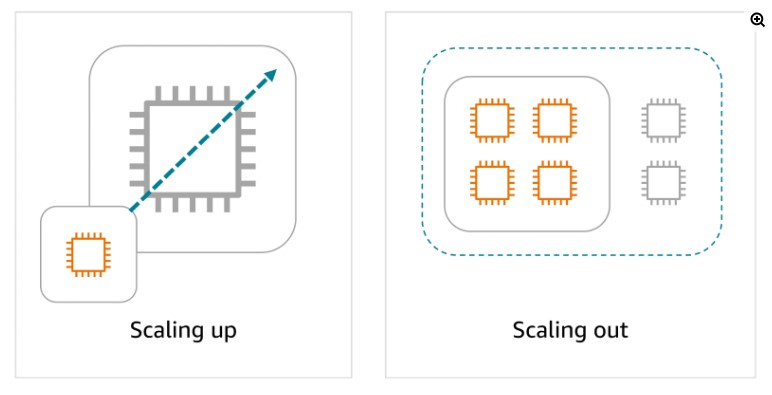

### Elasticity
Elasticity is the ability to automatically adjust resources in real time based on **fluctuating demand**.

- Scale **out** when demand is high
- Scale **in** when demand decreases

This helps you use resources efficiently and only pay for what you need, even when traffic goes up and down throughout the day.

---

## Amazon EC2 Auto Scaling

**Amazon EC2 Auto Scaling** automatically adjusts the number of EC2 instances based on demand.  
This improves availability and helps control costs.

It supports two types of scaling:

- **Dynamic Scaling** → Reacts in real time to demand changes
- **Predictive Scaling** → Adds instances based on predicted demand

### Auto Scaling Group Settings

An Auto Scaling group has three important settings:

| Setting              | Description                                              | Example |
|----------------------|----------------------------------------------------------|---------|
| **Minimum Capacity** | Lowest number of instances that must always run          | 4       |
| **Desired Capacity** | Ideal number of instances Auto Scaling tries to maintain | 6       |
| **Maximum Capacity** | Highest number of instances that can be launched         | 12      |

- If you don’t set desired capacity, it defaults to minimum capacity.
- Auto Scaling always keeps the number of instances between minimum and maximum.

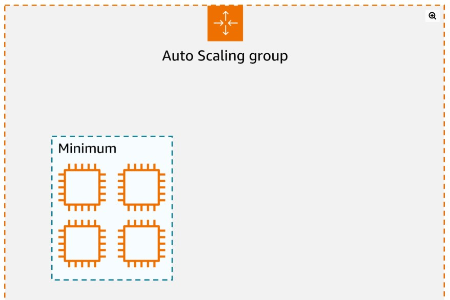  
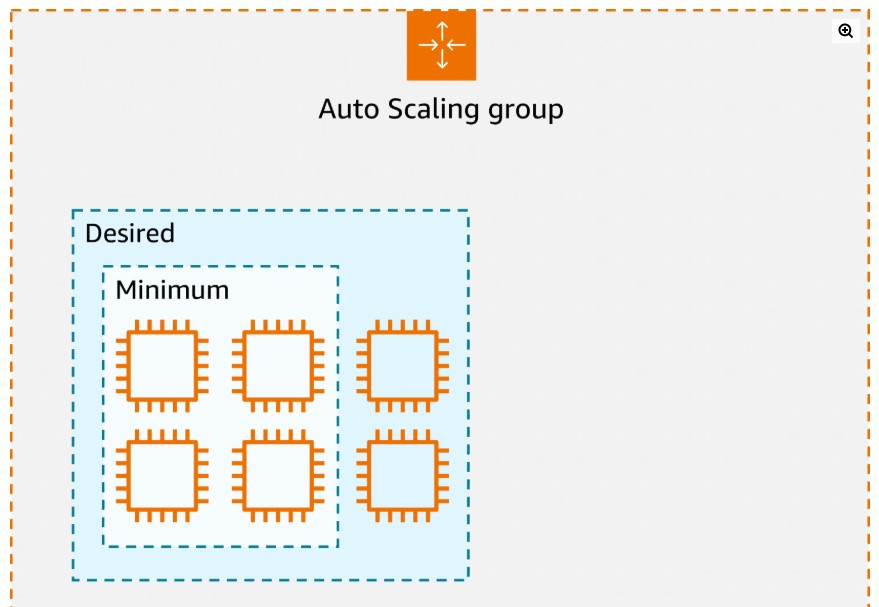  
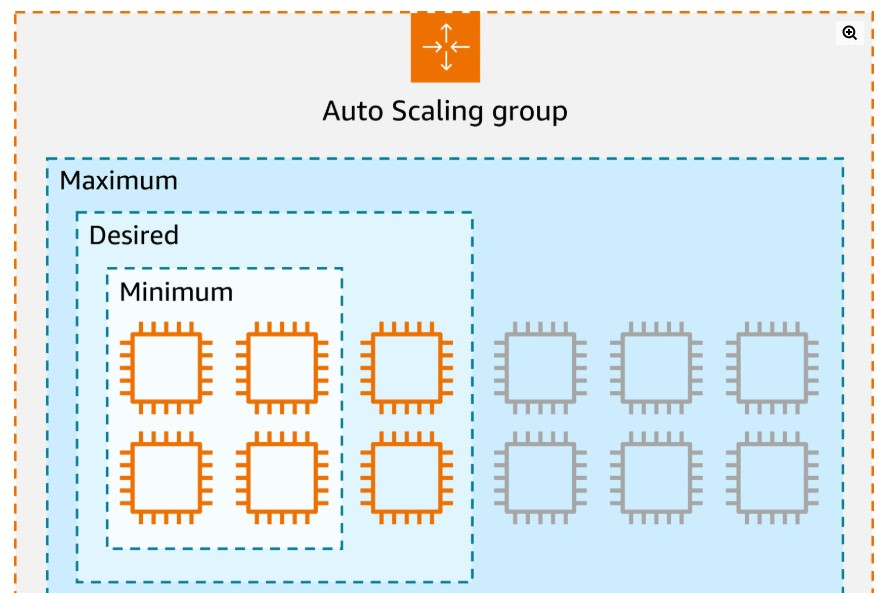

---

## Why Deploy Across Multiple Availability Zones?

Deploying EC2 instances across **multiple Availability Zones (AZs)** is important for high availability and fault tolerance.

- If one Availability Zone has an issue (power failure, network problem, etc.), your application can continue running in the other zones.
- Combined with Auto Scaling, it automatically replaces failed instances in healthy Availability Zones.
- This reduces the risk of downtime and improves reliability for your users.

---

### Simple Summary

- **Scale Up / Down** = Change the power of one server  
- **Scale Out / In** = Add or remove servers  
- **Scalability** = Ability to grow over time  
- **Elasticity** = Ability to automatically adjust to fluctuating demand  
- **EC2 Auto Scaling** = Automatically adds or removes instances using Minimum, Desired, and Maximum settings  
- **Multiple Availability Zones** = Protects your application from failures in a single location