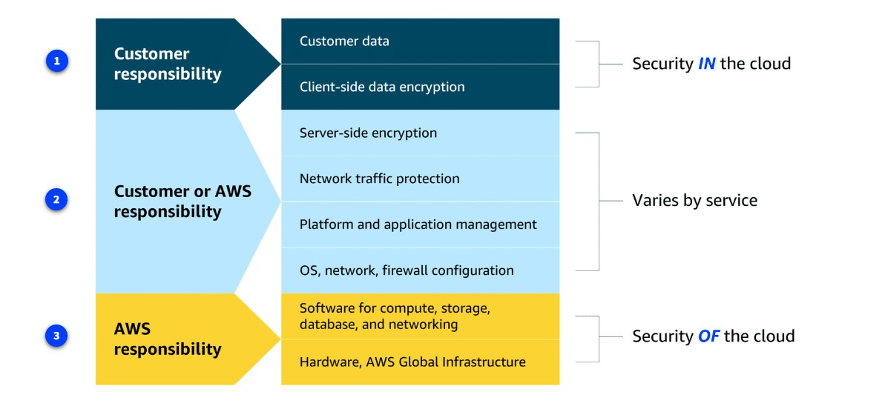

**Here’s the updated, fixed, and clear version:**

---

### Client-Server Model (CSM)
**Analogy: Coffee Shop**

- **Client** = Customer  
  The customer makes a request: “I want a latte.”

- **Server** = Barista / Shop  
  The barista receives the request, validates it, prepares the drink, and gives the response back to the customer.

**Simple flow:**  
Client → sends request → Server validates → Server sends response to Client

---

### Key Concept of AWS
**You only pay for what you use.**

**Coffee Shop Analogy:**  
Employees are only paid for the hours they actually work in the coffee shop.  
No work = no pay.

Same with AWS — you pay only for the resources you actually use.

---

### Brief History of AWS
- **2004** → Amazon Simple Queue Service (Amazon SQS) launched  
- **2006** → Amazon Simple Storage Service (S3) and Amazon Elastic Compute Cloud (EC2) launched  

At first, AWS was mainly used by small startups and developers.  
Later, because of its **scalability**, **cost-effectiveness**, and **ease of use**, larger enterprises also started using it.

Over the years, AWS kept expanding by adding more services like databases, networking, analytics, and many other cloud-based tools.

---

### What is Cloud Computing?
**Cloud computing** is the **on-demand delivery of IT resources over the internet** with **pay-as-you-go pricing**.

Let’s break it down:

#### 1. On-demand
Means you use resources only when you need them.

**Example:**  
Your business needs 2000 TB of storage.  
- Open an AWS account  
- Upload files to Amazon S3  
- You’re ready to go  

When you no longer need the files:  
→ Just delete them  
→ You stop paying immediately

#### 2. Delivery of IT Resources
This is the main idea that made AWS successful in the first place.

**Explanation:**  
Every application needs resources to run — storage for content, computing power, or tools to analyze data.  
All of this has to live and operate somewhere.

Traditionally, all data was stored in **data centers** — large buildings (or groups of buildings) filled with servers that hold and process data.

Data centers are designed with:
- Redundant power  
- Cooling systems  
- Strong security measures  

…to make sure everything runs securely and continuously.

**Before AWS:**  
Businesses had only two options:  
1. Build and run their own data centers, or  
2. Colocate (rent space) in someone else’s data center  

There was no real alternative. Managing infrastructure was repetitive, time-consuming, and expensive.

**After AWS became available:**  
Companies could now run their applications in data centers they **don’t own**.  
No more managing infrastructure.  
No more repetitive and time-consuming tasks.

**By using AWS, teams could now focus on innovation** instead of spending time on infrastructure.

#### 3. Over the Internet
You can access these resources **remotely** from anywhere.

#### 4. Pay-as-you-go Pricing
- You don’t need to own or manage any infrastructure  
- Just provision (create) what you need  
- When you’re done, simply deprovision (delete) it  
- No long-term contracts  
- No need to call a sales representative  

It’s simple and flexible.

---
**Here’s a simple and clear version:**

---

### Cloud Deployment Types

There are **3 main ways** to deploy cloud resources:

1. **Cloud-based**  
2. **On-premises**  
3. **Hybrid**

Each has its own advantages. Let’s look at them simply:

---

### 1. Cloud-based Deployment
Everything runs in the cloud.

You can:
- Move existing resources to the cloud
- Build completely new applications in the cloud
- Or do a mix of both

**Example:**  
A company moves its data to the cloud, then builds a new application using virtual servers, databases, and networking — all running in the cloud.

**Best for:** Flexibility, easy scaling, and no hardware management.

---

### 2. On-premises Deployment
Everything runs in your own data center (on your own servers).

Even if you use virtualization and management tools, this is still very similar to traditional (legacy) IT infrastructure.

**Pros:**
- Dedicated resources (only you use them)
- Very low latency (fast response times)

**Cons:**
- You don’t get most of the benefits of cloud computing (like easy scaling or pay-as-you-go)

**Best for:** When you need full control or very fast local performance.

---

### 3. Hybrid Deployment
A mix of both — some resources in the cloud + some resources on-premises.

They work together.

**Example:**  
A company keeps old regulated applications on-premises (because of rules or maintenance needs), but uses the cloud for advanced data processing and analytics.

**Note:**  
Using multiple cloud providers (multi-cloud) is also considered a type of hybrid deployment.

**Best for:** When you have legacy systems that must stay on-premises, or when you need a balance of control and cloud benefits.

---

**Quick Summary:**

| Type          | Where it runs              | Main Benefit                  | Best For                          |
|---------------|----------------------------|-------------------------------|-----------------------------------|
| Cloud-based   | Fully in the cloud         | Flexibility & easy scaling    | New apps & full cloud migration   |
| On-premises   | Your own data center       | Full control & low latency    | Strict control or legacy systems  |
| Hybrid        | Mix of cloud + on-premises | Best of both worlds           | Companies with mixed needs        |

---

### Six Main Benefits of the AWS Cloud

#### 1. Pay as you go (Trade fixed expenses for variable expenses)
In a traditional data center, you must invest a lot of money **upfront** (building, hardware, staff, maintenance).  
This creates a **fixed cost** every month — even if you don’t use everything.

With AWS:
- You start small
- You only pay for what you actually use
- Your bill changes every month based on usage
- No big upfront investment needed

---

#### 2. Benefit from massive economies of scale
AWS buys huge amounts of hardware for data centers around the world.  
Because they buy in bulk, they get lower prices — and they pass those savings on to you.

---

#### 3. Stop guessing capacity
In traditional data centers, you must guess how much capacity you’ll need in the future.

- If you buy **too much** → You waste money  
- If you buy **too little** → Your system may crash or customers leave

With AWS:
- You only provision what you need **right now**
- You can scale up or down in **minutes** (not weeks or months)

---

#### 4. Increase speed and agility
With AWS, you can quickly create test environments and try new ideas.

- If the idea works → Keep it  
- If it doesn’t work → Just delete the resources and stop paying  

This means less time managing infrastructure and **more time innovating**.

---

#### 5. Stop spending money running and maintaining data centers
You no longer need to:
- Buy servers
- Rack and stack hardware
- Manage power and cooling
- Maintain the physical data center

Instead, you can focus more on your customers and your business.

---

#### 6. Go global in minutes
Want to expand your business to another country (for example, from the US to India)?

Traditionally → This could take months or years (building new data centers).

With AWS → You can deploy your application to an AWS Region in that country in just **minutes**.

---

**Summary:**  
With AWS, your business gets:
- Cost savings
- Time savings
- Access to massive global infrastructure

**Here’s a simple and clear version of the next topic:**

---

## AWS Global Infrastructure

AWS builds and maintains data centers around the world.  
One big advantage of this global setup is **high availability**.

---

### Coffee Shop Analogy

Imagine you have a coffee shop.

One day, a new employee accidentally spills a latte on the register.  
The register breaks and the electricity goes out.  
→ That shop has to close temporarily.

But luckily, your coffee shop is a **chain** with many locations around the city.  
Customers can still buy coffee from another shop nearby.  
Your business continues running and making money.

This is the idea of **high availability**.

---

### High Availability vs Fault Tolerance

| Term                  | Simple Meaning                                                                 |
|-----------------------|--------------------------------------------------------------------------------|
| **High Availability** | Your application stays accessible with **minimal downtime**. Even if one part fails, another part takes over. |
| **Fault Tolerance**   | Your system is designed to keep working **even if multiple parts fail**. It builds extra protection at every level. |

---

### How AWS is Structured

AWS organizes its infrastructure in this way:

1. **Region**  
   - A physical location in the world (examples: Paris, Tokyo, São Paulo, Dublin, Ohio)  
   - Built close to customers

2. **Availability Zone (AZ)**  
   - Each Region has **3 or more Availability Zones**  
   - AZs are separated from each other (not right next to each other)  
   - This protects against natural disasters or local failures

3. **Data Center**  
   - Inside each Availability Zone, there are one or more data centers  
   - Each data center has **redundant power, networking, and connectivity**

---

### Why This Design is Important

It’s risky to put everything in **one single data center**.  
If that data center has a power outage or disaster → all applications go down.

That’s why AWS uses:
- Multiple Availability Zones inside a Region
- Multiple Regions around the world

Many companies even run their applications across **multiple Regions**.  
If one Region has a problem, traffic can automatically move (failover) to another Region.

---

**In short:**  
AWS Global Infrastructure is designed so your applications stay **highly available** and **fault tolerant** — even during problems or disasters.

**Here’s a simple and clear version:**

---

## AWS Shared Responsibility Model

**Main Idea:**  
Security on AWS is a **shared** responsibility between **AWS** and **you (the customer)**.

Both sides are responsible for keeping everything secure.

---

### Simple Analogy: Building a House

- **AWS** = The construction company  
  They build the house with strong walls and solid doors.

- **You (Customer)** = The homeowner  
  You are responsible for locking the doors and keeping the house secure.

---

### Who is Responsible for What?

| Responsibility                      | Who is Responsible? | Simple Explanation |
|-------------------------------------|---------------------|--------------------|
| **Security of the Cloud**           | AWS                 | Physical buildings, hardware, network, and the virtualization layer (hypervisor) |
| **Security in the Cloud**           | Customer (You)      | Your operating system, applications, data, and how you configure everything |

---

### AWS Responsibilities (Security of the Cloud)
AWS takes care of:
- Physical security of data centers (locks, cameras, access control)
- Network security
- Hypervisor (the layer that separates different customers’ workloads)

You don’t need to worry about the buildings or the hardware.

---

### Customer Responsibilities (Security in the Cloud)
You are 100% responsible for:
- Your **Operating System** (installing updates and patches)
- Your **Applications**
- Your **Data** (who can access it and whether it is encrypted)
- User accounts and access control
- Configuring security settings correctly

**Important:**  
AWS cannot log into your operating system or fix your applications for you.  
Just like a construction company won’t come lock your front door every day.

---

---

### About Your Data
You control your data completely:
- You decide who can see it
- You can encrypt it
- Even if someone gains access, encrypted data stays unreadable - if in the AWS 

---

**Remember this simple rule:**

> **AWS** is responsible for security **of** the cloud.  
> **You** are responsible for security **in** the cloud.

Together, this creates a secure environment.

## Applying Cloud Concepts to Real-Life Use Cases

### Example: E-commerce Company Expanding Globally

An e-commerce company wants to expand its business worldwide. It can use two AWS concepts to achieve this: **AWS Global Infrastructure** and the **AWS Shared Responsibility Model**.

### 1. AWS Global Infrastructure 

- **Regions:** The company can deploy its application closer to customers to reduce latency.
- **Availability Zones (AZs):** The company can deploy its application across multiple AZs so it can continue operating if one AZ fails.

**Example:** 
Regions: A company serving customers in Europe and Asia can deploy its application in the AWS Ireland Region and Singapore Region.
Availability Zones (AZs): A company deploys its application in two AZs within the Ireland Region so that the application can continue operating if one AZ fails.

### 2. AWS Shared Responsibility Model

AWS and the customer share responsibility for security.

- **AWS:** Secures the cloud infrastructure, including physical data centers, hardware, and networking.
- **Customer:** Secures its data, applications, access permissions, and security configurations.

**Example:** AWS secures the physical servers, while the company protects customer information and manages access to its application.

### Summary

By combining these two concepts, a business can:

- Reach customers around the world.
- Reduce latency by deploying closer to customers.
- Improve availability by using multiple Availability Zones.
- Keep its applications and data secure through shared responsibilities.